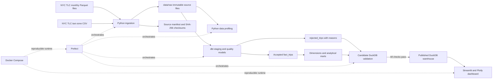

# NYC Taxi Demand and Fare Analytics Pipeline

DSAI5102 end-to-end batch data pipeline using NYC Yellow Taxi
Trip Records and the official Taxi Zone Lookup Table.

## Problem and motivation

NYC Yellow Taxi trip data contains millions of detailed records, but the
raw monthly files are not immediately suitable for dependable analysis.
They include invalid timestamps and locations, unusual trip values,
financial adjustments, missing values and records outside the intended
period. Manually combining and cleaning the files would be difficult to
repeat and easy to perform inconsistently.

This project builds a reproducible batch pipeline that validates the
official source files, preserves traceability, separates accepted and
rejected records, creates an analytical warehouse and serves an
interactive dashboard. It supports questions such as:

- How do trip activity and recorded passenger charges change over time?
- Which weekdays and pickup hours have the most recorded trips?
- Which boroughs and taxi zones generate the most pickups?
- How are eligible trips and charges distributed by payment method?

Trips in this project measure recorded taxi activity, not unmet demand.

## Current scope

The pipeline processes January through June 2025.

The verified six-month build processes 24,083,384 source rows:

- 23,886,241 accepted trips
- 197,143 rejected trips
- 181 daily summary rows
- 12 successful dbt model builds and 43 passing dbt data tests
- 11 passing focused Python tests

## Tools

- Python: downloading and profiling data
- Prefect: pipeline orchestration
- dbt: SQL transformations and data-quality tests
- DuckDB: analytical warehouse
- Streamlit and Plotly: interactive dashboard
- Docker Compose: running the project
- GitHub: team collaboration and version control

## Architecture



The project uses a batch design because the TLC publishes historical
monthly files and the analytical use case does not require real-time
updates.

## Component roles

| Component | Purpose in the implemented pipeline |
|---|---|
| Python ingestion and source validation | Downloads the six TLC Parquet files and zone CSV when absent; scans existing files for readable content and required schema before reuse. A changed checksum against the existing manifest stops the run. |
| Raw storage and source manifest | `data/raw/` retains source bytes. `source_manifest.json` records URLs, row counts, sizes and SHA-256 checksums for traceability and reconciliation. |
| Python profiling | Produces descriptive raw-data profiles before the analytical quality rules are applied. |
| Prefect orchestration | Runs source validation, profiling, dbt, candidate checks and publication in order, with task logs and failures. |
| dbt staging and quality classification | The two staging models expose typed trip and zone inputs as views. `int_trip_quality` is a table that classifies each physical trip row and records quality and financial flags. |
| dbt dimensions, fact and marts | Tables persist accepted `fact_trips`, `rejected_trips`, three dimensions and four tested analytical summaries. Tests check keys, partitioning and metric reconciliation. |
| DuckDB candidate warehouse and publication | dbt builds a separate candidate file. The pipeline checks its required tables, row reconciliation and IDs, checkpoints it, then replaces the published file only after success. |
| Streamlit and Plotly | Serve interactive KPIs and charts with pickup-date and borough filters. The dashboard reads `fact_trips` for metrics and `dim_payment_type` for payment labels. |
| Docker Compose | Builds the pinned Python environment, mounts local data, runs the pipeline and serves the dashboard in separate services. |

Staging uses views so typed source access does not duplicate the raw data in
the warehouse. Intermediate and mart models use tables so their classified
rows and analytical outputs are persisted for downstream tests and queries.

## Analytical data model

The warehouse uses a fact-and-dimension design:

- `fact_trips`: one accepted physical Parquet source row per record,
  enriched with locations, derived fields and quality indicators.
- `rejected_trips`: excluded records with a clear rejection reason.
- `dim_date`, `dim_zone`, `dim_payment_type`: reusable descriptive
  dimensions for analytical queries.
- `mart_daily_performance`: daily activity, charges and average metrics.
- `mart_hourly_demand`: trip activity by weekday and pickup hour.
- `mart_zone_performance`: trip and charge summaries by pickup zone.
- `mart_payment_summary`: trip and financial metrics by payment method.

The dashboard currently queries filtered `fact_trips` directly for its
KPIs and charts and joins `dim_payment_type` for payment labels. The marts
are tested, reusable analytical outputs; the dashboard does not read them.
The current marts do not all carry the date and borough detail needed to
answer every dashboard filter combination.

Stable trip IDs use source filename plus physical row number. This keeps
identical-content source records separate while preserving traceability.

## Pipeline

1. Download the trip records and taxi-zone lookup.
2. Preserve the original files in data/raw.
3. Generate a data-profiling report.
4. Build staging models and apply documented quality rules.
5. Create accepted and rejected trip tables.
6. Build dimensions and analytical summaries.
7. Run dbt tests and warehouse checks against a candidate DuckDB file.
8. Publish the candidate only after every check succeeds.
9. Display results through the dashboard.

## Project folders

- ingestion/: download and profiling scripts
- orchestration/: Prefect pipeline
- transformations/: dbt models, configuration and tests
- dashboard/: Streamlit application
- docs/: profiling report and cleaning rules
- data/raw/: downloaded source files
- data/warehouse/: generated DuckDB database
- data/rejected/: reserved for optional rejected-record exports

Rejected records currently remain in the warehouse's
rejected_trips table.

## Requirements

Install Git and Docker Desktop. The image uses Python 3.11.14 and
the versions pinned in requirements.txt.
Keep Docker Desktop running when executing the commands below.

A separate local Python environment is not required for Docker.

Recommended local resources for the verified six-month build:

- Approximately 10 GB of free disk space for source, candidate and
  published warehouse files during processing
- At least 8 GB assigned to Docker Desktop
- Stable internet access for the first source download

The measured local-source rebuild and its environment are recorded in
`docs/verification/benchmark-2026-11-07.md`. A first run also needs source
downloads and an image build, which that benchmark did not include.

## Capacity and scaling

The current pipeline rebuilds the selected January-June 2025 dataset on
each run. The measured rebuild, machine and resource limits are documented
in `docs/verification/benchmark-2026-11-07.md`; those observations establish
sufficiency only for this tested six-month workload and environment.

For several years, future incremental processing could validate new or
changed source files and rebuild affected outputs while preserving stable
row identity, exact source reconciliation and safe publication. Dashboard
summaries would need enough date and borough detail to keep combined filters
correct. Distributed processing such as Spark should be evaluated if
measured runtime, memory, storage or workload needs exceed practical
single-machine capacity. Several years alone do not establish that need;
the six-month timings cannot guarantee performance at a larger size.

## Run the pipeline

Clone the repository and open a terminal in its root folder,
where docker-compose.yml is located.

Build the images and run:

```bash
docker compose build pipeline dashboard
docker compose run --rm pipeline python tests/synthetic_fixture.py
docker compose stop dashboard
docker compose run --rm pipeline
docker compose run --rm pipeline python -m unittest discover -s tests -p 'test_*.py'
docker compose run --rm pipeline python tests/verify_warehouse.py
```

The first build installs dependencies and may take several minutes.
Wait for the pipeline to complete successfully.
The synthetic fixture builds into a temporary database and uses no real TLC
download. Stop the dashboard before publishing the new warehouse, including
on Windows. The focused Python tests and warehouse verification run against
the completed published warehouse. `dbt build` writes its full results to
`data/verification/dbt-target/run_results.json` and its logs to
`data/verification/dbt-logs/`; both remain local and are ignored by Git.

## Start the dashboard

After the pipeline succeeds, run:

```bash
docker compose up -d dashboard
```

Open http://localhost:8501 in your browser.

Use the pickup-date range and pickup-borough filters
to explore the results. The sidebar's Reset filters button returns to
the full six-month period and all boroughs. Recorded charges may be displayed in
millions when large; the KPI help tooltip shows the exact amount.

## Rebuild after changes

Stop the dashboard before updating the warehouse:

```bash
docker compose stop dashboard
```

Rebuild the images and run the pipeline:

```bash
docker compose build pipeline dashboard
docker compose run --rm pipeline
```

Only after it succeeds, restart the dashboard:

```bash
docker compose up -d dashboard
```

The Docker images contain copies of the source code, so rebuild
the relevant service after changing its code.
The pipeline builds data/warehouse/nyc_taxi_candidate.duckdb,
closes and checkpoints it, then replaces the published file. A failed
build or test leaves nyc_taxi.duckdb intact. Keep the dashboard stopped
during publication, especially on Windows, where an open DuckDB file
can block replacement. If a run crashes, check that no pipeline is
running before removing data/warehouse/.pipeline.lock. Rerun the
pipeline to discard its incomplete candidate. dbt build itself is
not an all-or-nothing transaction.
Running dbt directly targets the candidate file; only the Prefect
pipeline validates and publishes it.

## Stop the services

```bash
docker compose down
```

The local data files remain in the project's data folder.

## Verification evidence

The October verification is in `docs/verification/summary.md` and
`details.json`. The separate November controlled rebuild is in
`docs/verification/benchmark-2026-11-07.md` and its JSON companion. Each
records its revision scope; the starting commit alone does not identify a
modified working tree. Full logs and generated dbt artifacts remain under
ignored `data/verification/` for independent review. See
`docs/verification/README.md` for the commands and evidence scope.

## Data-quality and metric definitions

- Raw source files are preserved unchanged.
- Existing source files are checked for schema and readability. An
  unusable file is renamed with an .invalid timestamp before a fresh
  download. data/raw/source_manifest.json records names, row counts,
  byte sizes, source URLs and SHA-256 checksums. Individual bad trip
  rows are classified by dbt rather than treated as source failure.
- The fact-table grain is one physical Parquet source row. trip_id is
  based on source filename and file row number, so it remains stable
  while the source bytes and name remain the same. A content fingerprint
  identifies identical records; duplicates remain separate accepted or
  rejected rows and are never silently dropped.
- Invalid records are retained in rejected_trips with a reason.
- Unusual records may be retained with quality flags.
- Records with missing or negative fare or total amounts are
  excluded from standard dashboard metrics.
- Missing financial amounts are not replaced with zero.
- Recorded charges represent passenger charges, not profit.
- Cash tips are not captured in the source tip field.
- Payment code 0 is labeled "Flex Fare trip".
- Average distance excludes zero-distance trips and trips
  exceeding 100 miles.
- Average duration excludes trips exceeding six hours.
- Trip duration is calculated in seconds divided by 60.
- The profiling report describes raw rows with ordered timestamps and
  nonnegative distance, fare, and total amounts. Its averages do not apply
  the dashboard's project-period, location, financial-eligibility, and
  metric-specific filters and therefore can differ from dashboard KPIs.
- Trips measure recorded activity, not unmet taxi demand.

See docs/cleaning_rules.md for the detailed rules.

## Tests

The pipeline runs dbt build, which builds models and runs tests.

Checks include:
- Required values and unique dimension keys
- Valid timestamps and January-June date scope
- No negative distances in accepted trips
- Rejection reasons for rejected records
- Source count equals accepted plus rejected counts
- Correct missing-financial and adjustment flags
- Source IDs appear exactly once across accepted and rejected outputs
- Daily, hourly, zone and payment counts and charges reconcile to
  eligible fact rows, with a $0.01 tolerance for floating-point totals

Passing tests confirms the implemented checks; it does not
guarantee that every source value is accurate.

## Verified results and initial findings

The final January-June 2025 build produced:

- 24,083,384 source rows
- 23,886,241 accepted trips
- 197,143 rejected trips
- 22,560,818 financially eligible trips
- 181 daily summary rows
- $637,824,068.09 in eligible recorded passenger charges
- 12 successful dbt model builds, 43 passing dbt data tests, and 11 passing
  focused Python tests

Initial dashboard findings include:

- Eligible recorded trips increased from 3.33 million in January to a
  high of 4.20 million in May.
- May also had the highest monthly eligible recorded charges at
  approximately $123.32 million.
- Pickup hour 18:00 had the largest six-month trip count.
- Upper East Side South was the leading pickup zone by trip count.
- The highest single-day eligible trip count was 163,855 on 17 May 2025.

These are descriptive findings from recorded trips and should not be
interpreted as causal explanations or measurements of unmet demand.

## Collaboration

Both members use the same repository and maintain their own
local datasets and database.

Use separate branches for changes and review pull requests
before merging.

Do not commit datasets, databases, Python environments,
passwords, .env files or generated dbt output.

## Remaining work

- Complete the final report and presentation.

## Data source

NYC Taxi and Limousine Commission:
https://www.nyc.gov/site/tlc/about/tlc-trip-record-data.page
